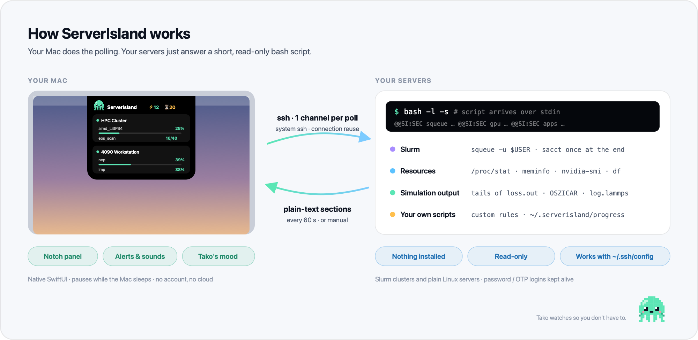
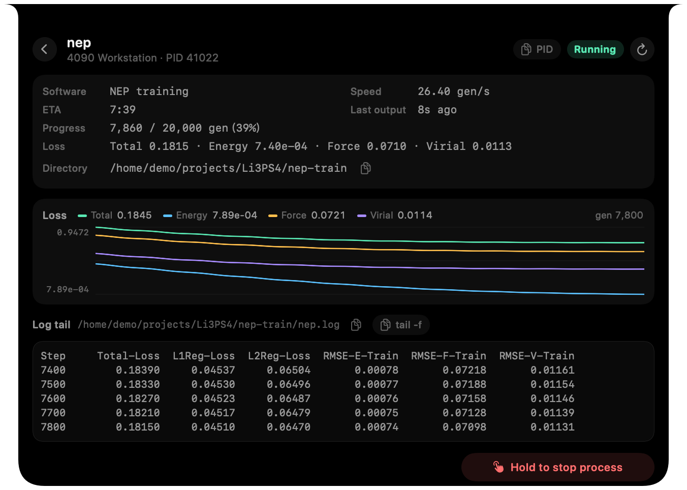
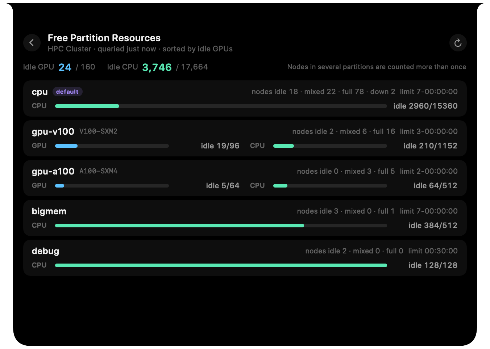
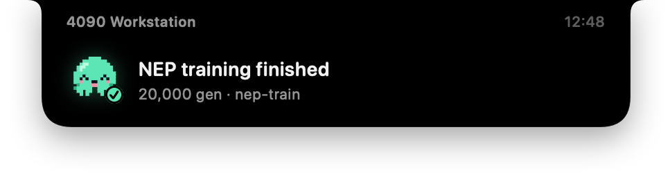
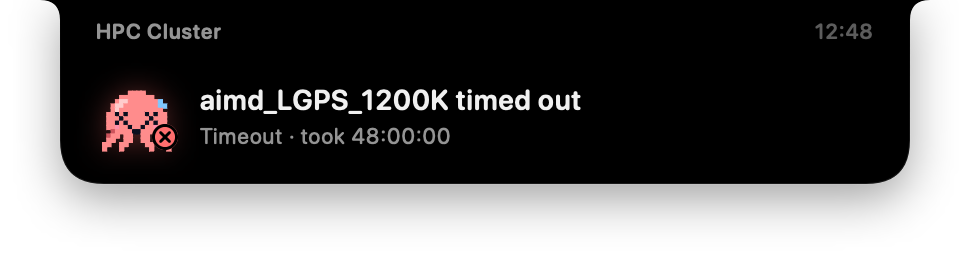
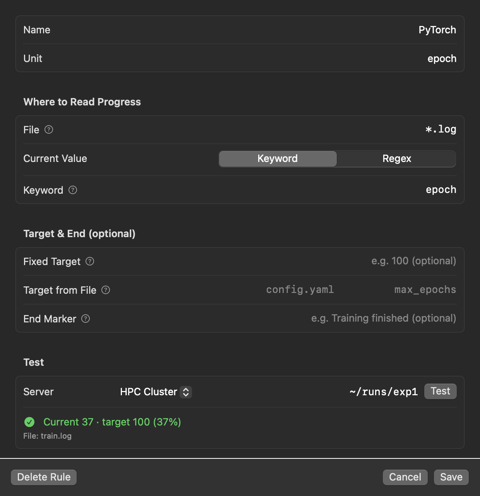
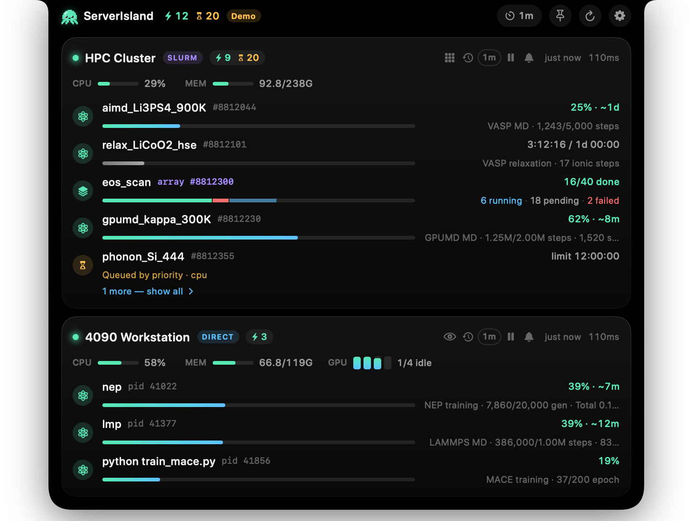
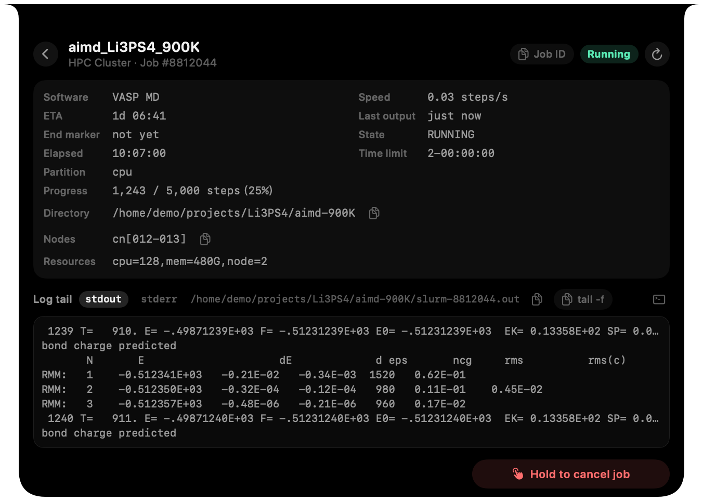
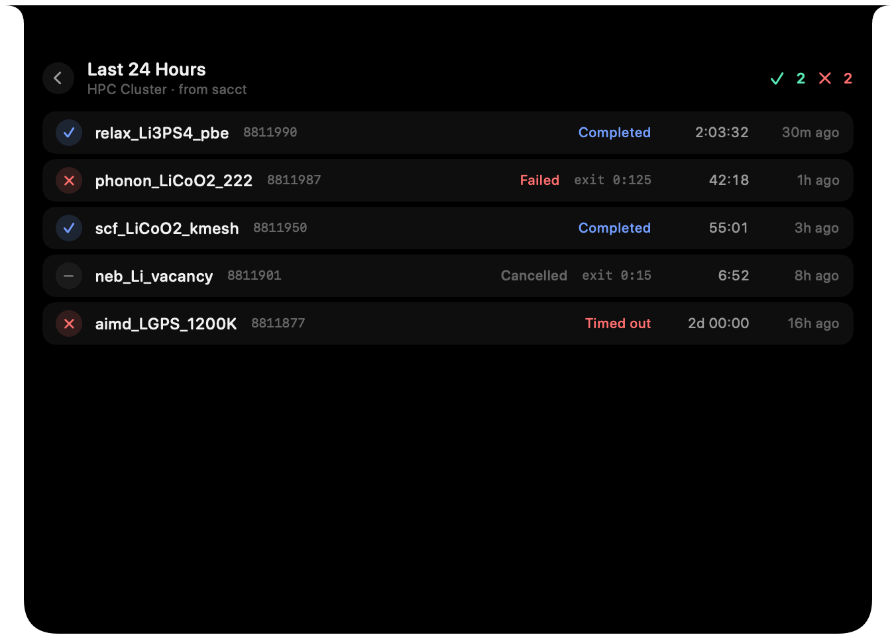

<p align="center">
  
</p>
<p align="center">
  <strong>English</strong>
  &nbsp;·&nbsp;
  <a href="./README.zh-CN.md">简体中文</a>
  &nbsp;·&nbsp;
  <a href="https://zhyan0603.github.io/ServerIsland/">Website</a>
  &nbsp;·&nbsp;
  <a href="https://github.com/zhyan0603/ServerIsland/releases/latest">Download</a>
  &nbsp;·&nbsp;
  <a href="./CONTRIBUTING.md">Contributing</a>
</p>
<p align="center">
  <a href="https://github.com/zhyan0603/ServerIsland/releases"></a>
  <a href="./LICENSE"></a>
  <a href="https://github.com/zhyan0603/ServerIsland/releases/latest"></a>
  <a href="https://github.com/zhyan0603/ServerIsland/releases"></a>
  <a href="https://github.com/zhyan0603/ServerIsland/stargazers"></a>
  <a href="https://github.com/zhyan0603/ServerIsland/graphs/contributors"></a>
</p>

<p style="text-align: justify;"><strong>ServerIsland</strong> puts your remote computations in the MacBook notch. It watches Slurm clusters and plain Linux servers over SSH and shows your jobs, GPUs and the <em>live progress</em> of VASP, LAMMPS, GPUMD and NEP runs in a Dynamic-Island-style panel — with nothing installed on the server. It is built for people who spend their days in computational materials science, chemistry and physics, and are tired of typing <code>squeue</code> and <code>tail -f</code> every twenty minutes.</p>

<p align="center">
  
</p>

## Features

- **Every Server at a Glance**: Hover the notch to see one card per server — running / pending counts, CPU, memory and GPUs. Idle servers fold into a single line.
- **Real Progress, Not Just "RUNNING"**: Detects NEP, GPUMD, VASP and LAMMPS from the job's working directory and shows progress, speed and ETA, plus loss and energy curves.
- **Slurm Done Right**: Job arrays as one segmented bar, pending reasons in plain words, free CPUs / GPUs per partition, and 24-hour history.
- **Alerts You Can Hear**: A notch pop-up with distinct sounds for success and failure — it can tell a clean finish from an early exit even without Slurm accounting.
- **Your Own Programs, Too**: Write a custom rule (a file name + a keyword or regex) and test it against a real directory right from Settings.
- **Zero Footprint**: No agent, no daemon, no root. One SSH channel per server per poll, reusing a single connection; your `~/.ssh/config` just works.
- **Safe by Default**: Cancelling is off unless enabled per server, and then needs a long press, a confirmation and a server-side re-check. Password / OTP logins go through a native dialog and are never stored.
- **Tako**: A pixel octopus lives in the notch — busy while jobs run, happy when they finish, red when something breaks.

## Supported Software

| Software | Detected from | What you see |
|---|---|---|
| **NEP / GNEP** | `loss.out` + `nep.in` / `gnep.in` | generation, losses, speed, ETA, loss curve |
| **GPUMD** | `run.in` + `neighbor.out` / `thermo.out` | steps, speed, ETA |
| **VASP** | `INCAR` + `OSZICAR` | MD as a percentage · relaxation as ionic steps with an energy curve · SCF as electronic steps |
| **LAMMPS** | `log.lammps` | steps of the last `run`; `Total wall time` marks a clean finish |
| **Anything else** | a custom rule | any *current / total* your program writes, e.g. `epoch 37/100` |

Detection only reads file tails. If anything doesn't look as expected, ServerIsland shows **nothing rather than a wrong number**. Missing your package? [Adding a detector](./CONTRIBUTING.md) is a great first contribution.

## Installation

### Download (Recommended)

Download the DMG from [Releases](https://github.com/zhyan0603/ServerIsland/releases/latest) and drag **ServerIsland** into Applications. Requires macOS 14 or later (Apple silicon and Intel).

ServerIsland is not notarized by Apple, so macOS blocks the first launch once:

- **macOS 15 and later**: open the app, then go to *System Settings → Privacy & Security* and click **Open Anyway**.
- **macOS 14**: Control-click the app and choose **Open**.
- Or run:

  ```bash
  xattr -dr com.apple.quarantine /Applications/ServerIsland.app
  ```

### From Source

Only the Xcode Command Line Tools are needed:

```bash
git clone https://github.com/zhyan0603/ServerIsland.git
cd ServerIsland
./scripts/build_app.sh --run
```

## Usage

1. On first launch, the settings window opens. Click **Add Server** and pick hosts from your `~/.ssh/config`.
2. Choose **Slurm** or **Direct** for each server (or let ServerIsland detect it).
3. That's it — hover the notch.

Want to look around first? Start the demo with fake servers:

```bash
open /Applications/ServerIsland.app --args --demo
```

<details>
<summary><b>Report progress from your own scripts</b></summary>

Besides custom rules, any script can write a one-line JSON file to `~/.serverisland/progress/<name>.json` on the server:

```json
{"name": "train", "progress": 0.62, "message": "epoch 62/100", "jobid": "8812044"}
```

Entries with a `jobid` are merged into that Slurm job. [`remote/si-progress`](./remote/si-progress) is a ready-made helper:

```bash
si-progress train 0.42 "epoch 3/10"
si-progress train done
```
</details>

## How It Works

<p align="center">
  <picture>
    <source media="(prefers-color-scheme: dark)" srcset="./docs/architecture-dark.png">
    
  </picture>
</p>

ServerIsland uses the system `/usr/bin/ssh` with `BatchMode=yes`, so it never hangs on a password prompt in the background, and backs off exponentially on errors so it never trips fail2ban. Slurm sees one `squeue -u $USER` per poll and a single `sacct` when a job leaves the queue. Everything stays on your Mac — no account, no cloud, no telemetry.

## Screenshots

<p align="center">
  <br>
  <sub><b>Job details</b> — live progress, an incrementally updated loss curve and the log tail.</sub>
</p>

<p align="center">
  <br>
  <sub><b>Partitions</b> — where can my job start right now?</sub>
</p>

<p align="center">
  
  <br>
  <sub><b>Alerts</b> — a ding when it's done, a dong when it isn't.</sub>
</p>

<p align="center">
  <br>
  <sub><b>Custom rules</b> — fill in a file and a keyword, then hit Test.</sub>
</p>

<details>
<summary><b>More screenshots</b></summary>
<p align="center">
  <br>
  <br>
  
</p>
</details>

## Roadmap

- [x] Slurm, direct servers, GPUs, job arrays, pending reasons, partitions
- [x] NEP / GNEP, GPUMD, VASP and LAMMPS detection, custom rules
- [x] Loss / energy curves in job details
- [ ] More packages: CP2K, Quantum ESPRESSO, ABACUS, Gaussian, ORCA
- [ ] PBS / Torque and LSF
- [ ] Display selection on multi-monitor setups
- [ ] Auto-update

## Contributing

Bug reports, ideas and pull requests are welcome, in English or Chinese — see [CONTRIBUTING.md](./CONTRIBUTING.md). The developer docs ([`AGENTS.md`](./AGENTS.md), [`references/`](./references/)) cover the architecture, the remote script protocol and how to add a new simulation package. If ServerIsland saves you a few `ssh` round-trips a day, a ⭐ helps others find it.

## Acknowledgements

Notch interaction inspired by [Pulse](https://github.com/jsattler/Pulse), [claude-island](https://github.com/farouqaldori/claude-island), [open-vibe-island](https://github.com/Octane0411/open-vibe-island) and [boring.notch](https://github.com/TheBoredTeam/boring.notch). Agent-free SSH monitoring ideas from [VRAMRadar](https://github.com/XinbaoQiao/VRAMRadar), [NVBeacon](https://github.com/jaein4722/NVBeacon) and [RemoteGPU-Bar](https://github.com/ZeyuuuChen/RemoteGPU-Bar). NEP / GPUMD progress logic follows [GPUMDkit](https://github.com/zhyan0603/GPUMDkit).

## License

Copyright © 2026 Zihan Yan and ServerIsland contributors. ServerIsland is free software released under the [GNU General Public License v3.0](./LICENSE): you may use, modify and redistribute it, and any modified version you distribute must also be open source under the GPL.
