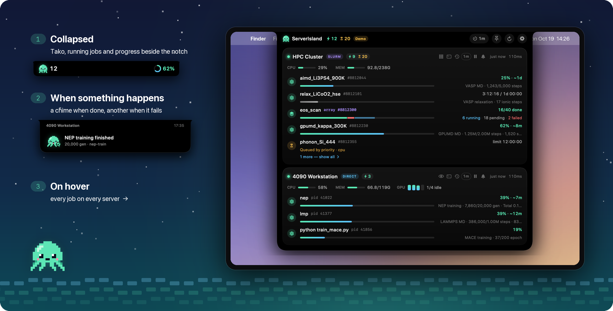
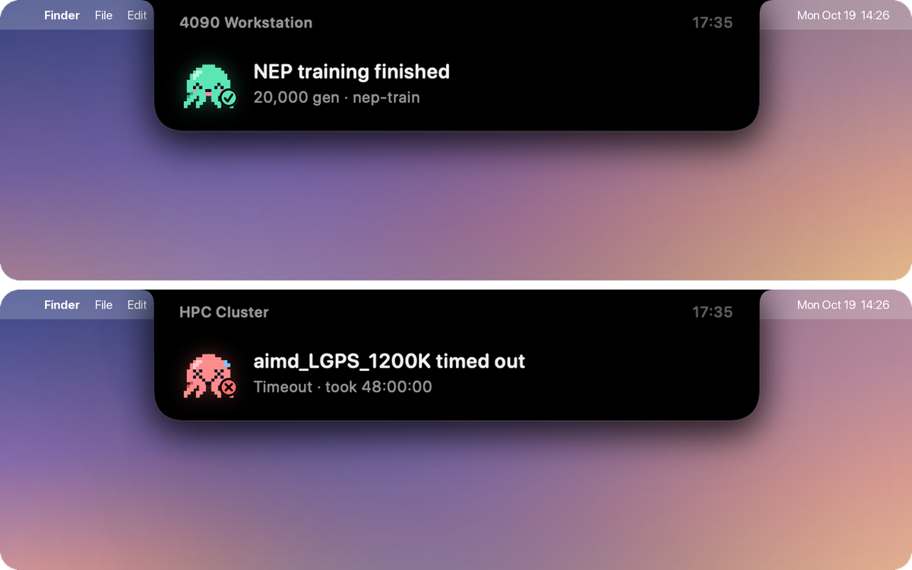
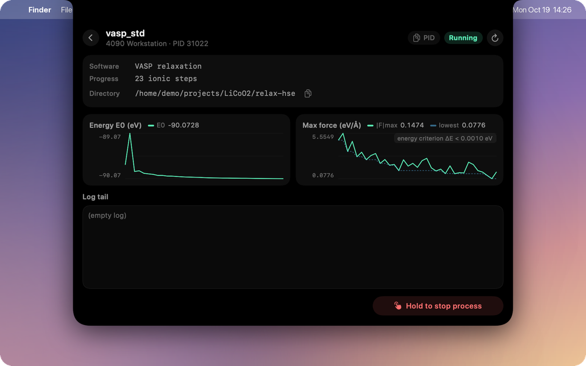
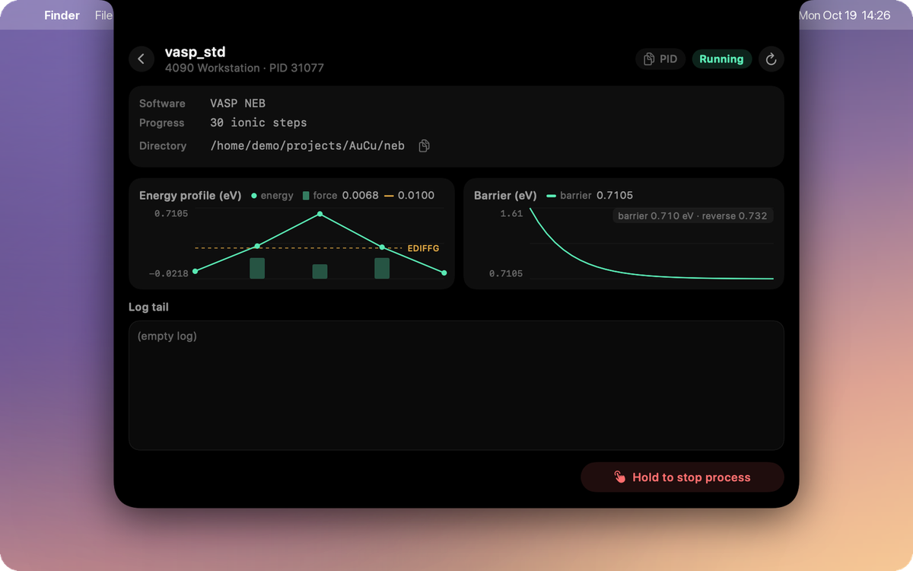
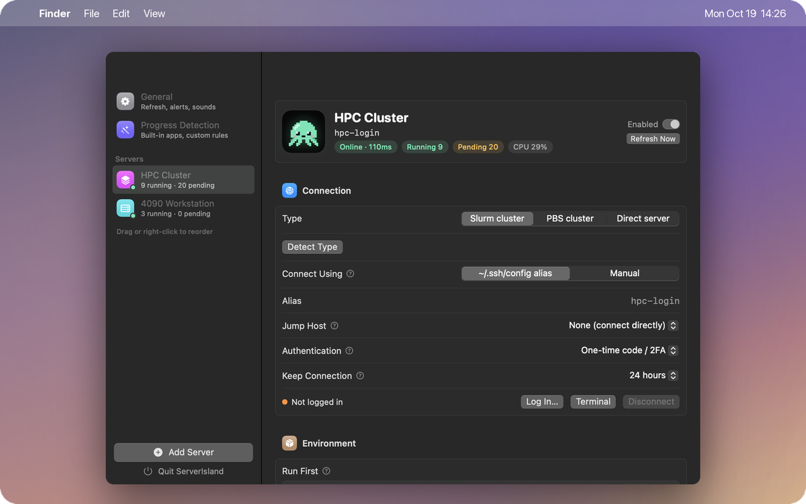
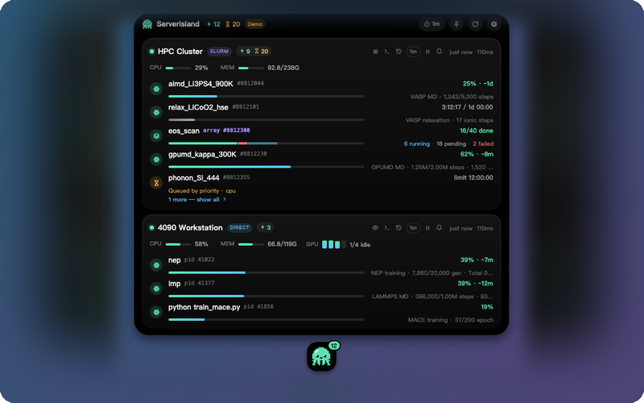

<p align="center">
  
</p>
<p align="center">
  <strong>English</strong>
  &nbsp;·&nbsp;
  <a href="./README.zh-CN.md">简体中文</a>
  &nbsp;·&nbsp;
  <a href="https://zhyan0603.github.io/ServerIsland/">Website</a>
  &nbsp;·&nbsp;
  <a href="https://zhyan0603.github.io/ServerIsland/manual.html">Guide</a>
  &nbsp;·&nbsp;
  <a href="https://github.com/zhyan0603/ServerIsland/releases/latest">Download</a>
  &nbsp;·&nbsp;
  <a href="./CONTRIBUTING.md">Contributing</a>
</p>
<p align="center">
  <a href="https://github.com/zhyan0603/ServerIsland/releases"></a>
  <a href="./LICENSE"></a>
  <a href="https://github.com/zhyan0603/ServerIsland/releases/latest"></a>
  <a href="https://github.com/zhyan0603/ServerIsland/releases/latest"></a>
  <a href="https://github.com/zhyan0603/ServerIsland/releases/latest"></a>
  <a href="https://github.com/zhyan0603/ServerIsland/releases"></a>
  <a href="https://github.com/zhyan0603/ServerIsland/stargazers"></a>
  <a href="https://github.com/zhyan0603/ServerIsland/graphs/contributors"></a>
</p>

<p style="text-align: justify;"><strong>ServerIsland</strong> puts your remote computations in the MacBook notch — and, on Windows and Linux, at the top of your screen or on your desktop. It watches Slurm and PBS clusters and plain Linux servers over SSH and shows your jobs, GPUs and the <em>live progress</em> of VASP, LAMMPS, GPUMD and NEP runs in a Dynamic-Island-style panel — with nothing installed on the server. It is built for people who spend their days in computational materials science, chemistry and physics, and are tired of typing <code>squeue</code> and <code>tail -f</code> every twenty minutes.</p>

<p align="center">
  <a href="https://zhyan0603.github.io/ServerIsland/"></a>
</p>
<p align="center">▶ <a href="https://zhyan0603.github.io/ServerIsland/manual.html#video-guide">Watch the 3-minute video tour</a></p>

## Features

- **Every Server at a Glance**: Hover the notch to see one card per server — running / pending counts, CPU, memory and GPUs. Idle servers fold into a single line.
- **Real Progress, Not Just "RUNNING"**: Detects NEP, GPUMD, VASP and LAMMPS from the job's working directory and shows progress, speed and ETA, plus loss curves and, for VASP relaxations, energy and max-force curves.
- **Slurm and PBS Done Right**: Job arrays as one segmented bar, pending reasons in plain words, free CPUs / GPUs / DCUs per Slurm partition, and 7 days of history with each job's folder. PBS Pro, OpenPBS and Torque work too.
- **Only What You Care About**: Limit a server to jobs and processes under certain folders, e.g. `~/projects/LLZO`.
- **Alerts You Can Hear**: A notch pop-up with distinct sounds for success and failure — it can tell a clean finish from an early exit even without Slurm accounting.
- **Your Own Programs, Too**: Write a custom rule (a file name + a keyword or regex) and test it against a real directory right from Settings.
- **Zero Footprint**: No agent, no daemon, no root. One SSH channel per server per poll, reusing a single connection; your `~/.ssh/config` just works — or type the address, user, port and key into Settings if you never wrote one.
- **Any Login**: Key, password, key + password, or one-time codes, optionally through one or more jump hosts — each hop asks and reports errors on its own.
- **Safe by Default**: Cancelling is off unless enabled per server, and then needs a long press, a confirmation and a server-side re-check. Passwords and one-time codes are typed into a native dialog and not stored by default; tick “Remember” to keep a password in the system keychain (one-time codes are never stored).
- **Tako**: A pixel octopus lives in the notch — busy while jobs run, happy when they finish, red when something breaks.

## Supported Software

| Software | Detected from | What you see |
|---|---|---|
| **NEP / GNEP** | `loss.out` + `nep.in` / `gnep.in` | generation, losses, speed, ETA, loss curve |
| **GPUMD** | `run.in` + `neighbor.out` / `thermo.out` | steps, speed, ETA |
| **VASP** | `INCAR` + `OSZICAR` | MD as a percentage · relaxation as ionic steps with an energy curve · SCF as electronic steps |
| **LAMMPS** | `log.lammps` | steps of the last `run`; `Total wall time` marks a clean finish |
| **Anything else** | a custom rule | any *current / total* your program writes, e.g. `epoch 37/100` |

Detection only reads file tails. If anything doesn't look as expected, ServerIsland shows **nothing rather than a wrong number**. Missing your package? [Adding a detector](./CONTRIBUTING.md) is a great first contribution.

## Installation

Download the package for your platform from **[Releases](https://github.com/zhyan0603/ServerIsland/releases/latest)**. No account, no extra runtime, and nothing to install on your servers.

| Platform | Download | Requirements |
|---|---|---|
| **macOS** | `ServerIsland-x.y.z.dmg` | macOS 14+, Apple silicon or Intel |
| **Windows** | `ServerIsland-x.y.z-win-x64.zip` | Windows 10 / 11, 64-bit |
| **Linux** | `ServerIsland-x.y.z-linux-x64.tar.gz` | x64, X11 or XWayland, a system tray |

- **macOS**: open the DMG and drag **ServerIsland** into Applications. It isn't notarized by Apple, so the first launch is blocked once: on macOS 15+, open it, then click **Open Anyway** in *System Settings → Privacy & Security*; on macOS 14, Control-click the app and choose **Open**.
- **Windows**: unzip anywhere and double-click `ServerIsland.exe`. If you see "Windows protected your PC", click **More info → Run anyway**.
- **Linux**: `tar xzf ServerIsland-*.tar.gz && ./ServerIsland`. On GNOME, install the AppIndicator extension so the tray icon shows up.

On Windows and Linux there's no notch: ServerIsland hangs from the top center of the screen, or lives on your desktop as Tako the pet (*Settings → General → Display Style*), with a tray icon either way.

## Usage

1. On first launch, the settings window opens. Click **Add Server** and pick hosts from your `~/.ssh/config`.
2. Choose **Slurm**, **PBS** or **Direct** for each server (or let ServerIsland detect it).
3. That's it — hover the notch (or the island / Tako on Windows and Linux).

Want to look around first? Start the demo with fake servers: `open /Applications/ServerIsland.app --args --demo` on macOS, `ServerIsland.exe --demo` on Windows, `./ServerIsland --demo` on Linux.

The **[User Guide](https://zhyan0603.github.io/ServerIsland/manual.html)** covers logins with passwords / one-time codes, alerts, custom progress rules and troubleshooting; the **[Feature Tour](https://zhyan0603.github.io/ServerIsland/features.html)** explains everything ServerIsland does.

<details>
<summary><b>Report progress from your own scripts</b></summary>

Besides custom rules, any script can write a one-line JSON file to `~/.serverisland/progress/<name>.json` on the server:

```json
{"name": "train", "progress": 0.62, "message": "epoch 62/100", "jobid": "8812044"}
```

Entries with a `jobid` are merged into that Slurm job. [`remote/si-progress`](./remote/si-progress) is a ready-made helper:

```bash
si-progress train 0.42 "epoch 3/10"
si-progress train done
```
</details>

## How It Works

<p align="center">
  <picture>
    <source media="(prefers-color-scheme: dark)" srcset="./docs/architecture-dark.png">
    
  </picture>
</p>

On macOS and Linux, ServerIsland uses the system `ssh` with a shared connection and `BatchMode=yes`; on Windows it keeps one connection per server with a built-in SSH client that reads your `~/.ssh/config` and `known_hosts`. Either way it never hangs on a password prompt in the background, and it backs off exponentially on errors so it never trips fail2ban. Slurm sees one `squeue -u $USER` per poll and a single `sacct` when a job leaves the queue. Everything stays on your computer — no account, no cloud, no telemetry.

## Screenshots

<table>
  <tr>
    <td width="50%" align="center"><br><sub><b>Every server at a glance</b> — one card per server; idle ones fold into a line</sub></td>
    <td width="50%" align="center"><br><sub><b>Alerts</b> — one sound when a job finishes, another when it fails</sub></td>
  </tr>
  <tr>
    <td width="50%" align="center"><br><sub><b>NEP training</b> — progress, ETA, a live loss curve and the log tail</sub></td>
    <td width="50%" align="center"><br><sub><b>VASP relaxation</b> — energy and max force against your EDIFFG target</sub></td>
  </tr>
  <tr>
    <td width="50%" align="center"><br><sub><b>VASP NEB</b> — the energy profile and how the barrier converges</sub></td>
    <td width="50%" align="center"><br><sub><b>Free resources</b> — where can my job start right now?</sub></td>
  </tr>
  <tr>
    <td width="50%" align="center"><br><sub><b>7-day history</b> — finished jobs, exit codes and their folders</sub></td>
    <td width="50%" align="center"><br><sub><b>Custom rules</b> — a file and a keyword, then hit Test</sub></td>
  </tr>
  <tr>
    <td width="50%" align="center"><br><sub><b>Any login</b> — key, password, one-time code, jump hosts</sub></td>
    <td width="50%" align="center"><br><sub><b>Windows &amp; Linux</b> — a virtual island, or Tako on your desktop</sub></td>
  </tr>
</table>

## Roadmap

- [x] Slurm, direct servers, GPUs, job arrays, pending reasons, partitions
- [x] NEP / GNEP, GPUMD, VASP and LAMMPS detection, custom rules
- [x] Loss / energy / max-force curves in job details
- [x] PBS (PBS Pro / OpenPBS / Torque), folder filters, log retention
- [x] Windows and Linux versions
- [x] Display selection on multi-monitor setups
- [x] One-click updates, server reordering, a terminal button on each card
- [ ] More packages: CP2K, Quantum ESPRESSO, ABACUS, Gaussian, ORCA
- [ ] LSF

## Contributing

Bug reports, ideas and pull requests are welcome, in English or Chinese — see [CONTRIBUTING.md](./CONTRIBUTING.md), which also explains how to build from source. The developer docs ([`AGENTS.md`](./AGENTS.md), [`references/`](./references/)) cover the architecture, the remote script protocol and how to add a new simulation package. If ServerIsland saves you a few `ssh` round-trips a day, a ⭐ helps others find it.

## Contact

Questions, feedback or ideas? Please [open an issue](https://github.com/zhyan0603/ServerIsland/issues) so others can find the answer too, or email **Zihan Yan** at [yanzihan@westlake.edu.cn](mailto:yanzihan@westlake.edu.cn).

## Acknowledgements

Notch interaction inspired by [Pulse](https://github.com/jsattler/Pulse), [claude-island](https://github.com/farouqaldori/claude-island), [open-vibe-island](https://github.com/Octane0411/open-vibe-island) and [boring.notch](https://github.com/TheBoredTeam/boring.notch). Agent-free SSH monitoring ideas from [VRAMRadar](https://github.com/XinbaoQiao/VRAMRadar), [NVBeacon](https://github.com/jaein4722/NVBeacon) and [RemoteGPU-Bar](https://github.com/ZeyuuuChen/RemoteGPU-Bar). NEP / GPUMD progress logic follows [GPUMDkit](https://github.com/zhyan0603/GPUMDkit).

## License

Copyright © 2026 Zihan Yan and ServerIsland contributors. ServerIsland is free software released under the [GNU General Public License v3.0](./LICENSE): you may use, modify and redistribute it, and any modified version you distribute must also be open source under the GPL.
