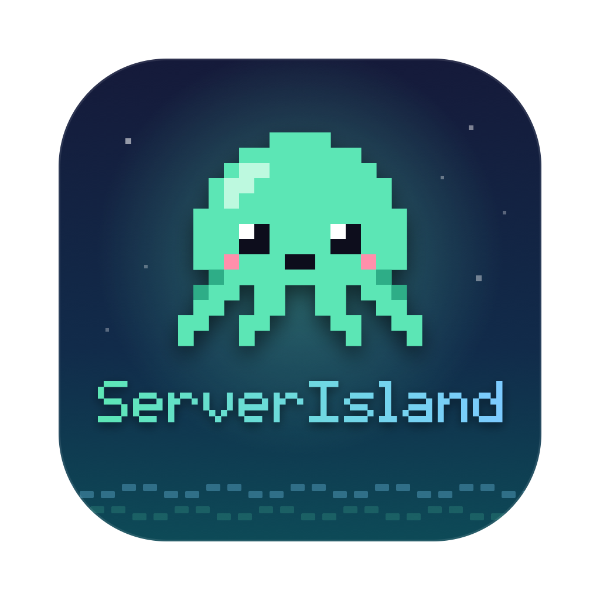
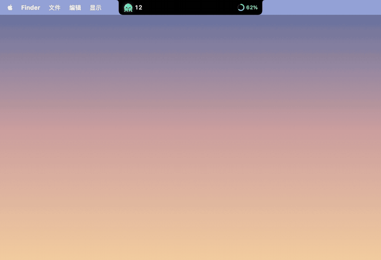
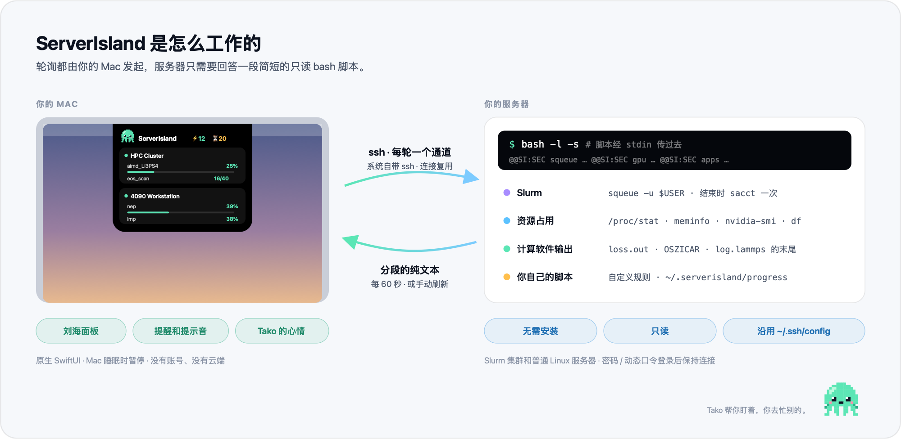
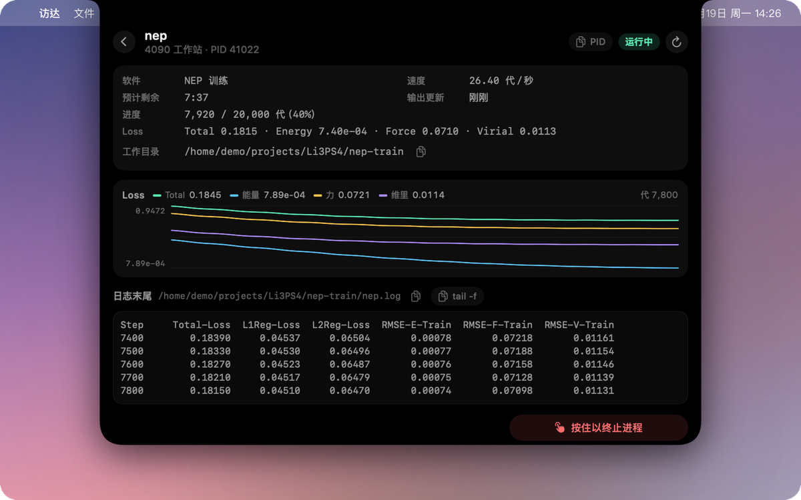
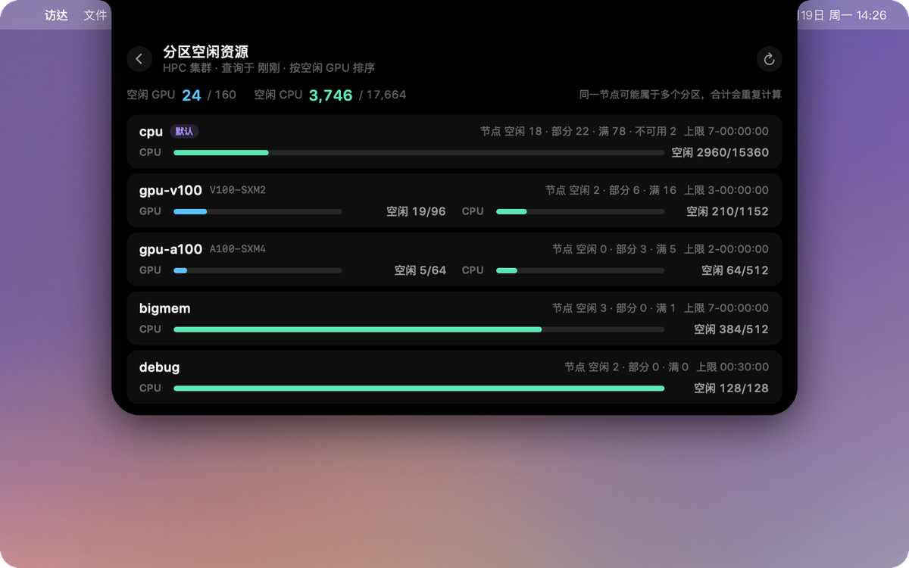
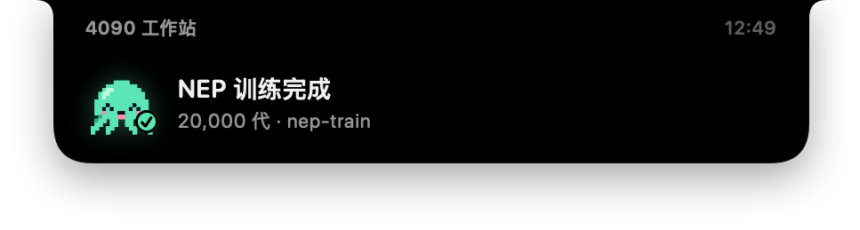
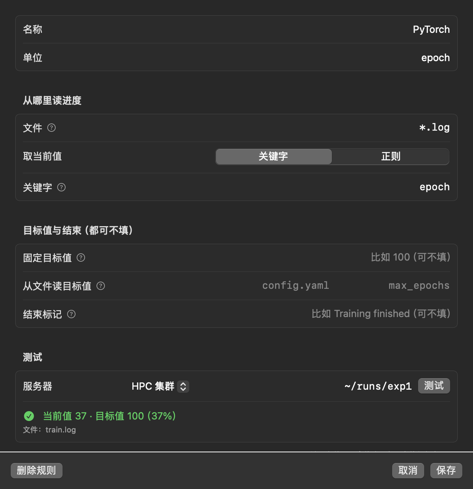
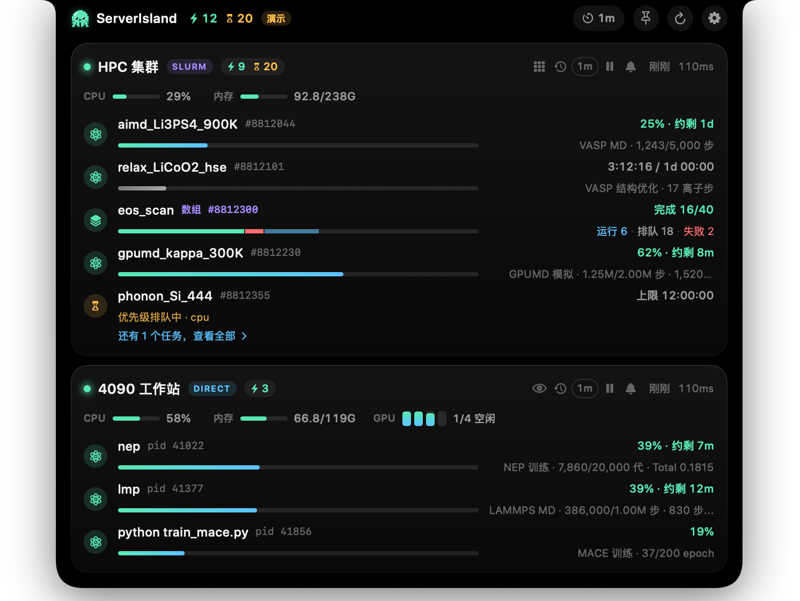
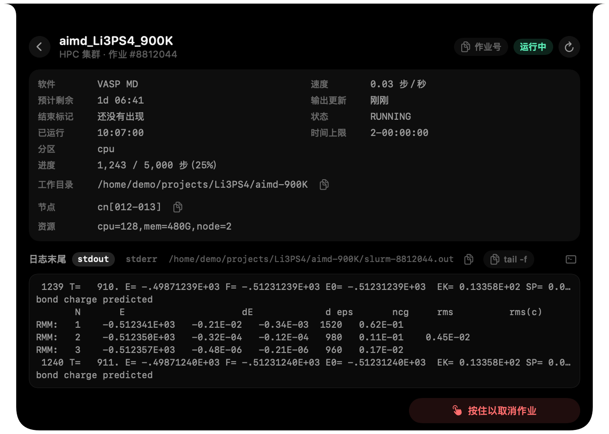
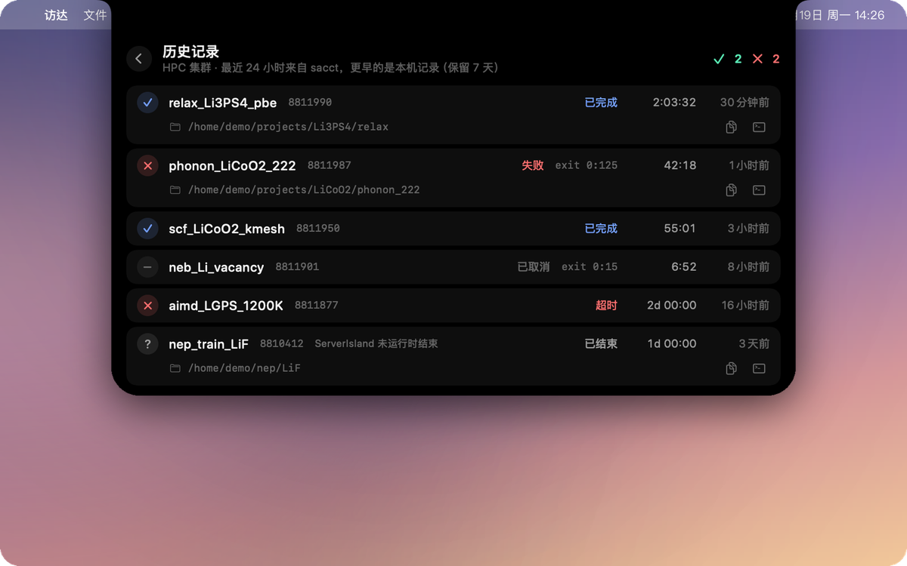

<p align="center">
  
</p>
<p align="center">
  <a href="./README.md">English</a>
  &nbsp;·&nbsp;
  <strong>简体中文</strong>
  &nbsp;·&nbsp;
  <a href="https://zhyan0603.github.io/ServerIsland/">官网</a>
  &nbsp;·&nbsp;
  <a href="https://zhyan0603.github.io/ServerIsland/manual.html">使用手册</a>
  &nbsp;·&nbsp;
  <a href="https://github.com/zhyan0603/ServerIsland/releases/latest">下载</a>
  &nbsp;·&nbsp;
  <a href="./CONTRIBUTING.md">参与贡献</a>
</p>
<p align="center">
  <a href="https://github.com/zhyan0603/ServerIsland/releases"></a>
  <a href="./LICENSE"></a>
  <a href="https://github.com/zhyan0603/ServerIsland/releases/latest"></a>
  <a href="https://github.com/zhyan0603/ServerIsland/releases/latest"></a>
  <a href="https://github.com/zhyan0603/ServerIsland/releases/latest"></a>
  <a href="https://github.com/zhyan0603/ServerIsland/releases"></a>
  <a href="https://github.com/zhyan0603/ServerIsland/stargazers"></a>
  <a href="https://github.com/zhyan0603/ServerIsland/graphs/contributors"></a>
</p>

<p style="text-align: justify;"><strong>ServerIsland</strong> 把你的远程计算装进 MacBook 的刘海里；在 Windows 和 Linux 上，它待在屏幕顶部或你的桌面上。它通过 SSH 查看 Slurm、PBS 集群和普通 Linux 服务器，把作业、GPU 占用，以及 VASP、LAMMPS、GPUMD、NEP 的<em>实时进度</em>放进一个"灵动岛"式的面板，服务器上什么都不用装。它为每天和计算材料、计算化学、计算物理打交道的人而做，让你不用再每隔二十分钟敲一遍 <code>squeue</code> 和 <code>tail -f</code>。</p>

<p align="center">
  
</p>

## 功能

- **一眼看完所有服务器**：鼠标移到刘海上，每台服务器一张卡片：运行数、排队数、CPU、内存、GPU。空闲的机器自动合并成一行。
- **真实进度，而不只是 "RUNNING"**：按工作目录里的文件识别 NEP、GPUMD、VASP、LAMMPS，显示进度、速度和剩余时间，还有 loss 曲线，VASP 结构优化的能量和最大力曲线。
- **好好对待 Slurm 和 PBS**：数组作业合并成一条分段进度条；排队原因翻译成人话；按需查看 Slurm 各分区的空闲 CPU / GPU；最近 24 小时历史。PBS Pro、OpenPBS、Torque 也支持。
- **只看你关心的**：可以让一台服务器只显示某些目录（比如 `~/projects/LLZO`）下的作业和进程。
- **听得见的提醒**：刘海弹窗，成功和失败是两种提示音。就算集群没开作业记录，也能分辨正常结束还是提前退出。
- **你自己的程序也行**：写一条自定义规则（文件名 + 关键字或正则），在设置里就能对着服务器上的真实目录当场测试。
- **服务器上零负担**：不装 agent、不跑守护进程、不要 root。每台机器每轮一个 SSH 通道，并复用同一条连接；`~/.ssh/config` 照常生效，没写过也可以在设置里直接填地址、用户名、端口和私钥。
- **各种登录方式**：密钥、密码、密钥 + 密码、动态口令都支持；可以经过一级或多级跳板机，每一跳分别询问、分别报错。
- **默认就安全**：取消任务默认关闭，要按服务器单独打开；打开后也要长按、二次确认，执行前还会在服务器上再核对一次。密码 / 动态口令用原生对话框输入，默认不保存；勾选“记住密码”时只存进系统钥匙串（动态口令从不保存）。
- **Tako**：刘海里住着一只像素小章鱼，任务在跑时手舞足蹈，完成了开心蹦跶，出错了会变红。

## 支持的计算软件

| 软件 | 判断依据 | 你能看到 |
|---|---|---|
| **NEP / GNEP** | `loss.out` + `nep.in` / `gnep.in` | 代数、各项 loss、速度、剩余时间、loss 曲线 |
| **GPUMD** | `run.in` + `neighbor.out` / `thermo.out` | 步数、速度、剩余时间 |
| **VASP** | `INCAR` + `OSZICAR` | MD 显示百分比 · 结构优化显示离子步和能量曲线 · 单点显示电子步 |
| **LAMMPS** | `log.lammps` | 最后一段 `run` 的步数；以 `Total wall time` 判断正常结束 |
| **其他程序** | 自定义规则 | 程序输出的任意"当前 / 目标"，比如 `epoch 37/100` |

识别只读文件末尾；只要有一处和预期不一致，就**宁可不显示，也不给你一个错的数字**。你的软件不在列表里？[新增一种识别](./CONTRIBUTING.md)是很好的第一个贡献。

## 安装

从 **[Releases](https://github.com/zhyan0603/ServerIsland/releases/latest)** 下载对应平台的安装包即可：免费、不需要账号、不需要另装运行环境，服务器上也什么都不用装。

| 平台 | 下载 | 要求 |
|---|---|---|
| **macOS** | `ServerIsland-x.y.z.dmg` | macOS 14 及以上，Apple 芯片或 Intel |
| **Windows** | `ServerIsland-x.y.z-win-x64.zip` | Windows 10 / 11，64 位 |
| **Linux** | `ServerIsland-x.y.z-linux-x64.tar.gz` | x64，X11 或 XWayland，需要系统托盘 |

- **macOS**：打开 DMG，把 **ServerIsland** 拖进"应用程序"。App 没有经过 Apple 公证，第一次打开会被拦一下：macOS 15 及以后，先打开一次，再到 *系统设置 → 隐私与安全性* 点 **仍要打开**；macOS 14 按住 Control 点 App，选 **打开**。
- **Windows**：解压到任意位置，双击 `ServerIsland.exe`。如果出现"Windows 已保护你的电脑"，点 **更多信息 → 仍要运行**。
- **Linux**：`tar xzf ServerIsland-*.tar.gz && ./ServerIsland`。GNOME 需要装 AppIndicator 扩展才能看到托盘图标。

Windows 和 Linux 上没有刘海：ServerIsland 挂在屏幕顶部正中，也可以变成待在桌面上的小章鱼 Tako（*设置 → 通用 → 显示方式*），两种方式都有托盘图标。

## 使用

1. 第一次启动会打开设置。点 **添加服务器**，从 `~/.ssh/config` 里勾选机器。
2. 为每台机器选择 **Slurm**、**PBS** 或 **直连**（也可以自动检测）。
3. 完成，把鼠标移到刘海上看看（Windows / Linux 上是屏幕顶部的灵动岛或桌面上的 Tako）。

想先看看效果？用几台假服务器启动演示模式：macOS 上 `open /Applications/ServerIsland.app --args --demo`，Windows 上 `ServerIsland.exe --demo`，Linux 上 `./ServerIsland --demo`。

**[使用手册](https://zhyan0603.github.io/ServerIsland/manual.html)** 介绍了密码 / 动态口令登录、提醒、自定义进度规则和常见问题；**[功能详解](https://zhyan0603.github.io/ServerIsland/features.html)** 介绍了 ServerIsland 能做的每一件事。

<details>
<summary><b>让自己的脚本上报进度</b></summary>

除了自定义规则，脚本也可以往服务器的 `~/.serverisland/progress/<名称>.json` 写一行 JSON：

```json
{"name": "train", "progress": 0.62, "message": "epoch 62/100", "jobid": "8812044"}
```

带 `jobid` 的条目会合并到对应的 Slurm 作业上；`status` 填 `done` 或 `failed` 会触发提醒。[`remote/si-progress`](./remote/si-progress) 是现成的小工具：

```bash
si-progress train 0.42 "epoch 3/10"
si-progress train done
```
</details>

<details>
<summary><b>常见问题</b></summary>

- **非交互 shell 里找不到 `squeue`**：App 会自动从 `~/.bashrc` 等文件补全 PATH；还不行就在"连接后先执行"里写 `module load slurm`。
- **命令跑不通**：每条远程命令都能在设置里修改，"测试连接"会显示原始输出。
- **没收到提醒**：看诊断日志（设置 → 通用 → 文件与诊断 → 打开诊断日志），每次轮询、每个任务结束、每次提醒发没发都有记录。
</details>

## 工作原理

<p align="center">
  <picture>
    <source media="(prefers-color-scheme: dark)" srcset="./docs/architecture-zh-dark.png">
    
  </picture>
</p>

在 macOS 和 Linux 上，ServerIsland 使用系统自带的 `ssh`，复用同一条连接并开启 `BatchMode=yes`；在 Windows 上，它用内置的 SSH 为每台服务器保持一条连接，读取你的 `~/.ssh/config` 和 `known_hosts`。无论哪种方式，后台都不会卡在等密码上；出错时指数退避，不会触发 fail2ban。对 Slurm 来说，每轮只有一次 `squeue -u $USER`，作业离开队列时再调用一次 `sacct`。一切都留在你的电脑上：没有账号、没有云端、不收集任何数据。

## 截图

<p align="center">
  <br>
  <sub><b>任务详情</b>：实时进度、增量更新的 loss 曲线和日志末尾。</sub>
</p>

<p align="center">
  <br>
  <sub><b>分区空闲资源</b>：我的作业现在能在哪儿跑？</sub>
</p>

<p align="center">
  
  <br>
  <sub><b>提醒</b>：完成"叮咚"，失败"咚咚"。</sub>
</p>

<p align="center">
  <br>
  <sub><b>自定义规则</b>：填好文件和关键字，点"测试"。</sub>
</p>

<details>
<summary><b>更多截图</b></summary>
<p align="center">
  <br>
  <br>
  
</p>
</details>

## 路线图

- [x] Slurm、直连服务器、GPU、数组作业、排队原因、分区空闲资源
- [x] NEP / GNEP、GPUMD、VASP、LAMMPS 识别，自定义规则
- [x] 详情页的 loss / 能量 / 最大力曲线
- [x] PBS（PBS Pro / OpenPBS / Torque）、按目录过滤、日志保留天数
- [x] Windows 和 Linux 版
- [ ] 更多软件：CP2K、Quantum ESPRESSO、ABACUS、Gaussian、ORCA
- [ ] PBS / Torque 和 LSF
- [ ] 多显示器时选择显示在哪块屏幕
- [ ] 自动更新

## 参与贡献

欢迎提 Bug、提想法、发 Pull Request，中英文都可以，见 [CONTRIBUTING.md](./CONTRIBUTING.md)（从源码构建的方法也在那里）。开发文档（[`AGENTS.md`](./AGENTS.md)、[`references/`](./references/)）介绍了架构、远端脚本协议，以及怎样新增一种计算软件。如果 ServerIsland 每天帮你省下几次 `ssh`，点个 ⭐ 能让更多人看到它。

## 联系

有问题、反馈或想法？欢迎[提 Issue](https://github.com/zhyan0603/ServerIsland/issues)，这样其他人也能看到答案；也可以发邮件给 **Zihan Yan**：[yanzihan@westlake.edu.cn](mailto:yanzihan@westlake.edu.cn)。

## 致谢

刘海交互参考了 [Pulse](https://github.com/jsattler/Pulse)、[claude-island](https://github.com/farouqaldori/claude-island)、[open-vibe-island](https://github.com/Octane0411/open-vibe-island)、[boring.notch](https://github.com/TheBoredTeam/boring.notch)；免装 agent 的 SSH 监控参考了 [VRAMRadar](https://github.com/XinbaoQiao/VRAMRadar)、[NVBeacon](https://github.com/jaein4722/NVBeacon)、[RemoteGPU-Bar](https://github.com/ZeyuuuChen/RemoteGPU-Bar)。NEP / GPUMD 的进度判断参考了 [GPUMDkit](https://github.com/zhyan0603/GPUMDkit)。

## 许可证

Copyright © 2026 Zihan Yan and ServerIsland contributors. ServerIsland 是自由软件，按 [GNU 通用公共许可证第 3 版（GPL-3.0）](./LICENSE) 发布：你可以自由使用、修改和再分发；分发修改后的版本时，也必须以 GPL 公开全部源码。
