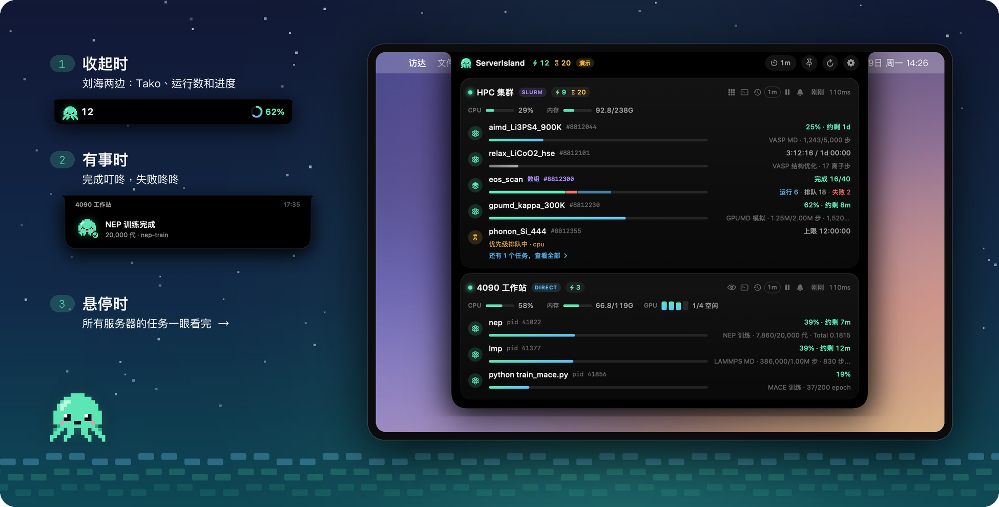
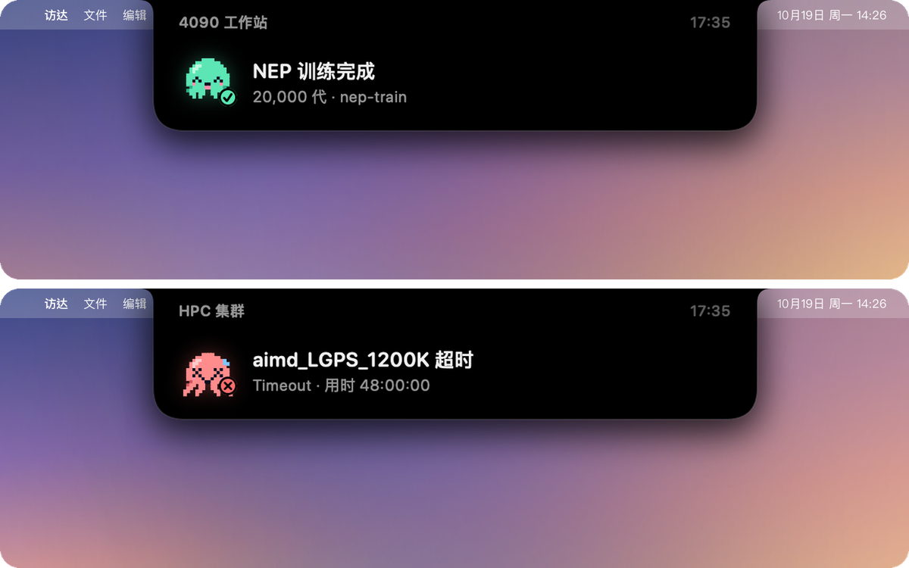
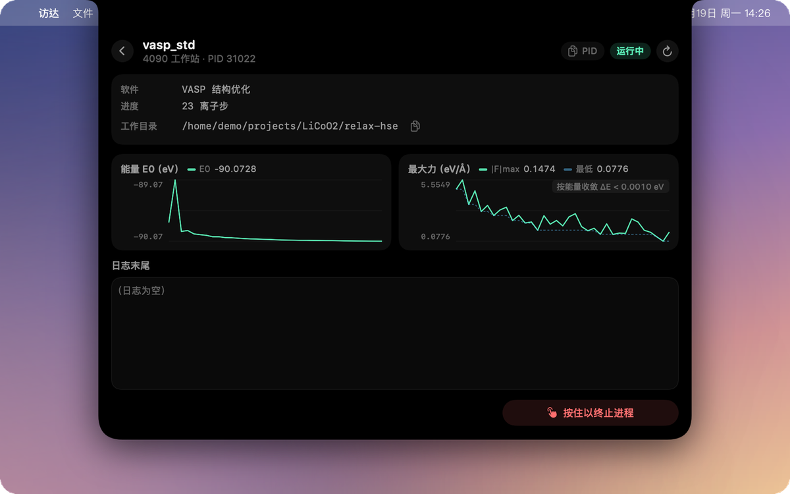
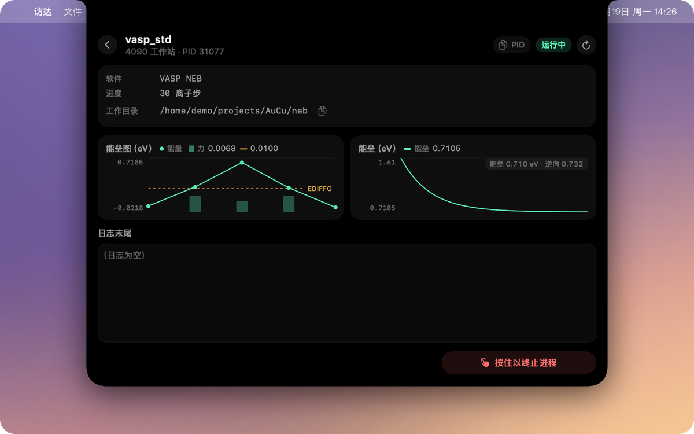
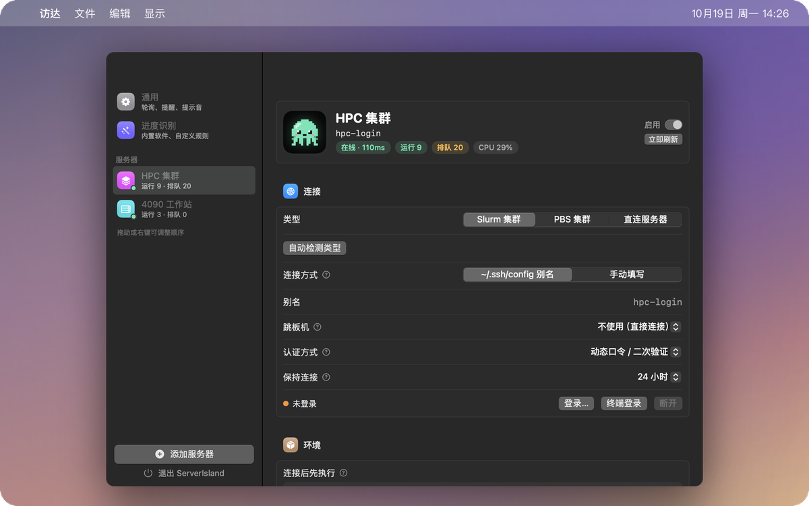
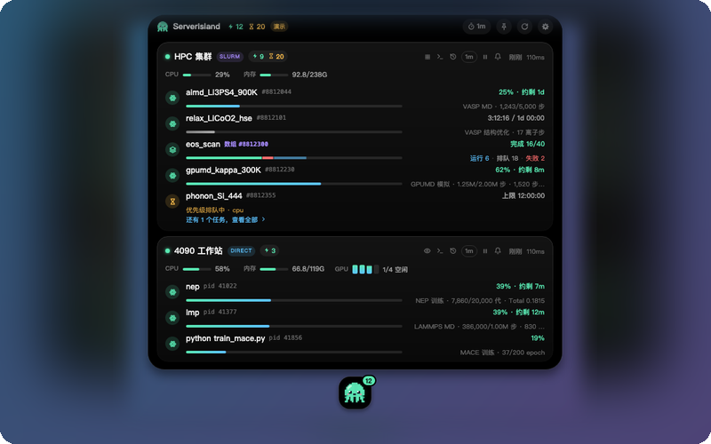

<p align="center">
  
</p>
<p align="center">
  <a href="./README.md">English</a>
  &nbsp;·&nbsp;
  <strong>简体中文</strong>
  &nbsp;·&nbsp;
  <a href="https://zhyan0603.github.io/ServerIsland/">官网</a>
  &nbsp;·&nbsp;
  <a href="https://zhyan0603.github.io/ServerIsland/manual.html">使用手册</a>
  &nbsp;·&nbsp;
  <a href="https://github.com/zhyan0603/ServerIsland/releases/latest">下载</a>
  &nbsp;·&nbsp;
  <a href="./CONTRIBUTING.md">参与贡献</a>
</p>
<p align="center">
  <a href="https://github.com/zhyan0603/ServerIsland/releases"></a>
  <a href="./LICENSE"></a>
  <a href="https://github.com/zhyan0603/ServerIsland/releases/latest"></a>
  <a href="https://github.com/zhyan0603/ServerIsland/releases/latest"></a>
  <a href="https://github.com/zhyan0603/ServerIsland/releases/latest"></a>
  <a href="https://github.com/zhyan0603/ServerIsland/releases"></a>
  <a href="https://github.com/zhyan0603/ServerIsland/stargazers"></a>
  <a href="https://github.com/zhyan0603/ServerIsland/graphs/contributors"></a>
</p>

<p style="text-align: justify;"><strong>ServerIsland</strong> 把你的远程计算装进 MacBook 的刘海里；在 Windows 和 Linux 上，它待在屏幕顶部或你的桌面上。它通过 SSH 查看 Slurm、PBS 集群和普通 Linux 服务器，把作业、GPU 占用，以及 VASP、LAMMPS、GPUMD、NEP 的<em>实时进度</em>放进一个"灵动岛"式的面板，服务器上什么都不用装。它为每天和计算材料、计算化学、计算物理打交道的人而做，让你不用再每隔二十分钟敲一遍 <code>squeue</code> 和 <code>tail -f</code>。</p>

<p align="center">
  <a href="https://zhyan0603.github.io/ServerIsland/"></a>
</p>
<p align="center">▶ <a href="https://zhyan0603.github.io/ServerIsland/manual.html#video-guide">观看 3 分钟视频教程</a></p>

> **本地定制版已合并官方 v0.3.0。** 保留 Actions、部署进度与识别规则、Docker 监控/控制/日志、收藏及界面定制。此版本保留官方版本检查，但禁止安装官方二进制覆盖定制功能；后续请合并源码再打包。

## 功能

- **一眼看完所有服务器**：鼠标移到刘海上，每台服务器一张卡片：运行数、排队数、CPU、内存、GPU。空闲的机器自动合并成一行。
- **真实进度，而不只是 "RUNNING"**：按工作目录里的文件识别 NEP、GPUMD、VASP、LAMMPS，显示进度、速度和剩余时间，还有 loss 曲线，VASP 结构优化的能量和最大力曲线。
- **好好对待 Slurm 和 PBS**：数组作业合并成一条分段进度条；排队原因翻译成人话；按需查看 Slurm 各分区的空闲 CPU / GPU / DCU；保留 7 天的历史记录，带工作目录。PBS Pro、OpenPBS、Torque 也支持。
- **只看你关心的**：可以让一台服务器只显示某些目录（比如 `~/projects/LLZO`）下的作业和进程。
- **听得见的提醒**：刘海弹窗，成功和失败是两种提示音。就算集群没开作业记录，也能分辨正常结束还是提前退出。
- **你自己的程序也行**：写一条自定义规则（文件名 + 关键字或正则），在设置里就能对着服务器上的真实目录当场测试。
- **服务器上零负担**：不装 agent、不跑守护进程、不要 root。每台机器每轮一个 SSH 通道，并复用同一条连接；`~/.ssh/config` 照常生效，没写过也可以在设置里直接填地址、用户名、端口和私钥。
- **各种登录方式**：密钥、密码、密钥 + 密码、动态口令都支持；可以经过一级或多级跳板机，每一跳分别询问、分别报错。
- **默认就安全**：取消任务默认关闭，要按服务器单独打开；打开后也要长按、二次确认，执行前还会在服务器上再核对一次。密码 / 动态口令用原生对话框输入，默认不保存；勾选“记住密码”时只存进系统钥匙串（动态口令从不保存）。
- **Tako**：刘海里住着一只像素小章鱼，任务在跑时手舞足蹈，完成了开心蹦跶，出错了会变红。

## 支持的计算软件

| 软件 | 判断依据 | 你能看到 |
|---|---|---|
| **NEP / GNEP** | `loss.out` + `nep.in` / `gnep.in` | 代数、各项 loss、速度、剩余时间、loss 曲线 |
| **GPUMD** | `run.in` + `neighbor.out` / `thermo.out` | 步数、速度、剩余时间 |
| **VASP** | `INCAR` + `OSZICAR` | MD 显示百分比 · 结构优化显示离子步和能量曲线 · 单点显示电子步 |
| **LAMMPS** | `log.lammps` | 最后一段 `run` 的步数；以 `Total wall time` 判断正常结束 |
| **其他程序** | 自定义规则 | 程序输出的任意"当前 / 目标"，比如 `epoch 37/100` |

识别只读文件末尾；只要有一处和预期不一致，就**宁可不显示，也不给你一个错的数字**。你的软件不在列表里？[新增一种识别](./CONTRIBUTING.md)是很好的第一个贡献。

## 安装

从 **[Releases](https://github.com/zhyan0603/ServerIsland/releases/latest)** 下载对应平台的安装包即可：免费、不需要账号、不需要另装运行环境，服务器上也什么都不用装。

| 平台 | 下载 | 要求 |
|---|---|---|
| **macOS** | `ServerIsland-x.y.z.dmg` | macOS 14 及以上，Apple 芯片或 Intel |
| **Windows** | `ServerIsland-x.y.z-win-x64.zip` | Windows 10 / 11，64 位 |
| **Linux** | `ServerIsland-x.y.z-linux-x64.tar.gz` | x64，X11 或 XWayland，需要系统托盘 |

- **macOS**：打开 DMG，把 **ServerIsland** 拖进"应用程序"。App 没有经过 Apple 公证，第一次打开会被拦一下：macOS 15 及以后，先打开一次，再到 *系统设置 → 隐私与安全性* 点 **仍要打开**；macOS 14 按住 Control 点 App，选 **打开**。
- **Windows**：解压到任意位置，双击 `ServerIsland.exe`。如果出现"Windows 已保护你的电脑"，点 **更多信息 → 仍要运行**。
- **Linux**：`tar xzf ServerIsland-*.tar.gz && ./ServerIsland`。GNOME 需要装 AppIndicator 扩展才能看到托盘图标。

Windows 和 Linux 上没有刘海：ServerIsland 挂在屏幕顶部正中，也可以变成待在桌面上的小章鱼 Tako（*设置 → 通用 → 显示方式*），两种方式都有托盘图标。

## 使用

1. 第一次启动会打开设置。点 **添加服务器**，从 `~/.ssh/config` 里勾选机器。
2. 为每台机器选择 **Slurm**、**PBS** 或 **直连**（也可以自动检测）。
3. 完成，把鼠标移到刘海上看看（Windows / Linux 上是屏幕顶部的灵动岛或桌面上的 Tako）。

首页主机内存默认显示已用/总量，仅点击时在容量数值与百分比之间切换，移除悬停变化。资源颜色为四档：低于 60% 绿色，60% 至不足 70% 青色，70% 至不足 85% 黄色，85% 起红色。主机未显示 GPU（没有 GPU 数据或关闭 GPU 显示）时，开启磁盘显示即可在同一区域看到 GPU 风格磁盘竖柱，无需达到高占用阈值。每个挂载点一根柱，完整浅灰底槽始终显示，彩色填充按实际比例从底部上升。点击磁盘区域可在百分比与已用/总容量之间切换，容量按大小统一显示为 GB 或 TB；多个磁盘时右侧对应占比最高的磁盘，悬停柱子可看各挂载点和容量；显示 GPU 时保留原 GPU 区域。

Mac 灵动岛内所有可滚动控件统一使用约 4pt、较高对比度的灰色细滚动条，包含纵向列表和横向日志。有溢出内容时持续显示，不再随覆盖式滚动条淡出；无需滚动时隐藏。保留原生拖拽和滚轮行为，不修改设置窗口的系统滚动条。

想先看看效果？用几台假服务器启动演示模式：macOS 上 `open /Applications/ServerIsland.app --args --demo`，Windows 上 `ServerIsland.exe --demo`，Linux 上 `./ServerIsland --demo`。

**[使用手册](https://zhyan0603.github.io/ServerIsland/manual.html)** 介绍了密码 / 动态口令登录、提醒、自定义进度规则和常见问题；**[功能详解](https://zhyan0603.github.io/ServerIsland/features.html)** 介绍了 ServerIsland 能做的每一件事。

<details>
<summary><b>Docker 容器指标（Mac）</b></summary>

Mac 新添加的服务器默认开启 Docker 显示，可在 **服务器设置 → 显示内容 → Docker** 关闭；已有服务器保留原设置。服务器卡片按现有任务样式展示容器状态、CPU 和内存，最多显示三项；点击容器进入详情，点击“查看全部”浏览其余容器。详情包含健康状态、镜像、Compose 服务、端口、PIDs、网络和磁盘 I/O 累计值及速率，可使用“刷新一次”。沿用服务器的轮询和暂停设置。

卡片和“查看全部”均可切换 **List / Grid**，两种视图的容器条目均沿用运行任务的浅白悬停高亮；两个入口的布局偏好按服务器独立保存，可以首页 Grid、全部 List；旧版配置先保留原显示方式。视图切换、排序和“查看全部”按钮提供与主机操作按钮一致的悬停高亮。视图切换、排序按钮的整个悬停矩形均可点击。“查看全部”的每项容器均可通过星标收藏，Grid 星标与标题行居中对齐并预留固定空间，长标题省略显示；收藏后星标仅变为实心，保持灰色，按服务器与容器名称保存，部署重建同名容器后继续有效。首页优先预览收藏的活动容器；全部列表依次展示收藏、其余活动、其余停止项，每组内沿用当前排序。Grid 各组独立起行，不填入前组空位。排序图标为紧凑灰色，两个入口继续共用排序。“查看全部”的数量放在第二行服务器名称后，以灰色显示为 `服务器名 · 13/15 运行中`，与监听进程页的副标题排版一致。首页只显示活动容器，隐藏已经停止或尚未运行的条目；“查看全部”将未收藏的停止项放在底部，各组内部按所选方式排序。容器全部列表和详情指标区按可用视口宽度排版，只允许纵向滚动；图表双列可收缩，CMD 等长文本换行，不产生横向滚动条。日志区仍保留独立的横向滚动。Grid 的停止组使用独立网格，从新的一行左侧开始，不填入活动组的空位。List 最多预览三项，Grid 双列预览四项；状态旁以灰色显示 Docker 原始 STATUS（如 `Up 3 hours (healthy)`），不额外重复 healthy。默认按创建/重建及生命周期变更时间倒序，可改为综合资源、CPU 或内存占用排序。综合资源取 CPU 容量占比与内存占比中的较大值；内存按占比排序，未知资源排后。最近变更来自 daemon 有限的事件历史，缺少事件时回退到容器创建时间，并保留 App 已观察到的变更时刻。

详情指标块与时序图使用较浅灰色底，增强与黑色岛面的区分；时间范围按钮同样提供悬停反馈。首页卡片显示时立即独立快读一次 Docker 列表，此后每 3 秒更新；收起首页或切换页面后停止，不触发主机全量刷新。“查看全部”在标题下提供与任务列表同样式的“全部 / 收藏 / 运行中 / 已停止 / 不健康”筛选胶囊，右侧显示筛选后数量，可与文字搜索叠加；List/Grid 同步生效，保留收藏优先和状态分组，返回详情列表时保留筛选。“运行中”匹配 running，“不健康”匹配 Docker 的 unhealthy，暂停或正在健康初始化的容器不混入这两类。“查看全部”的标题区提供与全部任务同样式的搜索框，可按容器名称、ID、镜像及 Compose 项目/服务筛选，支持空格分隔的多词匹配；仅过滤本机已有数据，不触发额外采集。List/Grid 共用搜索结果，保留收藏优先和状态分组，返回列表时保留查询，可一键清空。提示文字独立固定绘制，原生文字的显示、选中和编辑共用垂直居中的布局，聚焦不改变位置；列表打开时接收本面板按键，未聚焦搜索框时直接输入文字会聚焦并交给原生编辑器处理首键及输入法。快捷键、菜单和其它文本控件不重定向；离开列表后移除监听，不监听其它 App。

“查看全部”打开期间约每秒独立快读当前主机的 Docker 容器列表与状态，离开列表或进入详情后停止；首页与容器列表的 tips 使用跨刷新保留的原生提示区域，动态文字更新不重复登记；未变化的容器行和视图工具栏跳过无效时钟重建。鼠标命中范围按界面状态缓存，滚动条检查合并限频，不降低采集频率。自动更新不显示右上角加载动画；只有手动点击刷新时显示，若自动请求尚未完成，手动请求会等待后读取一次。刷新按钮也只读这份列表，不触发主机 CPU、内存、GPU、任务或其它主机刷新。列表快读不逐个采集容器 stats、inspect 或事件，资源数值保留最近真实采样；详情刷新按钮仅采所选容器。列表失败时保留上次数据并显示错误，迟到全局响应不会回滚最新成员与状态。

详情第一行以双列显示 CPU 和内存，资源条占满右侧百分比文字之外的可用宽度；第二行以四列并排显示网络接收、网络发送、磁盘读取、磁盘写入。每张指标卡两行：第一行标题与次要信息，第二行数值，CPU/内存资源条放在百分比之前。同页以 **2×2** 同时展示 CPU、内存、网络、磁盘 I/O 四张时序图，共用固定尺寸的 1、3、5、10 分钟按钮（默认 3 分钟），各图可独立点选读数。详情页和实时横轴保留每秒重绘；时间范围切换器作为独立控件，仅在选中范围或文案改变时更新，避免每秒刷新引起选中背景闪烁。切换器禁用刷新动画，图表、图例和空状态高度固定。

详情右上方刷新按钮左侧提供重启、停止、进入容器按钮；已停止的容器显示启动按钮。启动/停止/重启通过按钮下方带箭头的半透明毛玻璃气泡确认（卡片与箭头共用背景模糊材质，文字与按钮保持清晰），沿用灵动岛字体、圆角和操作配色，并显示目标容器及服务影响。取消、点击气泡外部或目标状态变化会关闭气泡；只有点击确认才执行。操作绑定完整容器 ID，执行前再次核对目标，不根据容器名操作。控制请求超时显示结果待确认，不自动重放。PIDs 与采样时间位于“指标 / 运行日志”同一行右侧；底部端口后显示容器 Config.Cmd 的参数；CMD 未设置或为空时显示 ENTRYPOINT，启动参数仅用于展示。

日志搜索与原工具栏同行，位于打开终端按钮左侧并使用剩余宽度；有查询时才显示匹配计数和上下定位图标。“指标/运行日志”使用固定浅灰选中样式，不随键盘焦点变蓝。日志页支持直接键入搜索当前已加载的 200/500 行，无需先点击输入框；回车键或上下箭头图标循环定位匹配（回车到最后一项后回到第一项，输入法确认候选字不触发跳转），显示当前项/总数，背景高亮保留 ANSI 文字颜色。搜索期间内容仍每秒更新，但不自动跳到第一个匹配或拉回末尾；高密度匹配最多高亮 2000 项并显示“+”。自动刷新不显示 loading，只有手动点击日志刷新按钮时显示。

运行日志工具栏在“自动刷新”前提供“时间戳”开关，默认关闭并记住选择；切换时立即更新显示，无需重新采集，也不移除日志正文中的日期。终端查看同样沿用点击时的时间戳开关和 200/500 行选择。

运行日志保留 ANSI 普通色、亮色、256 色及 RGB 前景色；未指定颜色或颜色重置后保持默认灰色。深色背景下提亮过暗文字，光标和超链接控制码不执行、不显示。仅在日志内容变化时解析颜色。采集端保留颜色码，原生日志文本直接应用分段颜色；首次查看默认横向最左侧，实时刷新保留用户横向位置。只有原本在底部时才自动跟随新日志；向上阅读时保持位置，tail 淘汰旧行时抵消被移除行的高度。

终端入口通过 macOS 默认的 `.command` 打开关联启动，不绑定 Terminal.app；沿用服务器 SSH 配置、跳板机、连接复用和前置命令。远端需要 docker CLI，容器内需要 sh，有 bash 时优先进入 bash。

打开容器详情后，额外启动仅针对当前容器的实时采样，目标间隔 1 秒，独立于全局或单台服务器的后台间隔；前一请求完成后才发下一次，实际周期受 SSH 和 Docker 响应时间影响。返回/关闭详情即取消，不再发起采样或合并迟到响应。部分结果仅更新该容器与真实时序数据，不覆盖其它容器、主机资源、全局刷新时刻；全局旧样本晚返回时也不会覆盖新样本。采样错误会显示并有界退避，认证及权限错误停止重试。后台仍按原设置轮询。仅积累本次 App 运行期间的实际轮询样本，每容器最多 600 点、最长 6 小时；重启 App 后重新积累，首次 I/O 速率仍需两次采样。

“运行日志”刷新按钮旁提供默认终端入口：点击时将当前选择的 200 或 500 行固定进启动脚本，终端先显示这些尾部日志，再持续跟踪新增内容。

“运行日志”读取 stdout/stderr 最近 200 或 500 行；自动刷新打开时独立按 1 秒目标间隔读取尾部，串行执行，离开日志页即停止。临时读取错误会自动退避重试，避免一次错误就永久停住；认证、日志驱动不支持或容器移除时显示原因并停止重试。兼容 Docker 多路复用及 TTY 输出，保留原始时间戳。日志仅保存在当前页面内存，显示上限 128 KiB，超长会提示截断，并对常见凭据格式做掩码。

采集器随 App 内置，通过现有 SSH 通道的 stdin 临时执行，以只读 GET 请求访问远端 Docker Engine 的 Unix socket，无需安装服务器端监控程序。需要服务器有 `python3`，且 SSH 用户有 socket 访问权限；默认查找 `/var/run/docker.sock`，也支持 `DOCKER_HOST=unix:///path/to/docker.sock` 和 rootless socket。不可访问时显示原因，不自动提权或修改权限。关闭开关后不再采集。

CPU 文字、资源条、排序和曲线使用相同口径：设置了容器硬限额时，按 NanoCpus、CFS quota/period、cpuset 中的有效较小容量计算；例如原始 CPU 为 107.3%、限额 2 核时显示 53.65%。未设置硬限额时沿用 Docker 的单核 100% 口径，107.3% 的条形图填满，不再按服务器总核心数稀释。悬停可看限额与原始 Docker CPU；详情标注限额或单核口径。CPU shares 是相对权重，不作为硬限额。限额通过只读 inspect 获取，只返回资源白名单字段，读取失败时明确标注未知并暂用单核口径。限额定义参见 [Docker 资源约束](https://docs.docker.com/engine/containers/resource_constraints/)。

内存按容器有效限额计算，若 daemon 报告更小的实际上限则取较小者；未配置容器内存限额时，悬停会注明按 daemon 报告的容量计算。Linux 内存按 [Docker stats](https://docs.docker.com/reference/cli/docker/container/stats/) 的工作集口径扣除缓存。I/O 速率需要连续两次有效采样；停止、未采样或采集失败的指标显示 `—`。为控制轮询开销，每次最多列出 200 个容器，采集前 16 个运行容器的资源指标，最多四个并发请求；达到限制时详情页会提示。容器不计入计算作业数量，不触发作业完成提醒。

本机验证：`python3 remote/test_docker_monitor.py` 使用临时假 Unix socket，不访问真实 Docker 或服务器。Swift 与跨平台核心共享 `remote/docker-monitor.py`；跨平台容器界面尚未接入。
</details>

<details>
<summary><b>让自己的脚本上报进度</b></summary>

除了自定义规则，脚本也可以往服务器的 `~/.serverisland/progress/<名称>.json` 写一行 JSON：

```json
{"name": "train", "progress": 0.62, "message": "epoch 62/100", "jobid": "8812044"}
```

带 `jobid` 的条目会合并到对应的 Slurm 作业上；`status` 填 `done` 或 `failed` 会触发提醒。[`remote/si-progress`](./remote/si-progress) 是现成的小工具：

```bash
si-progress train 0.42 "epoch 3/10"
si-progress train done
```

**Mac 本地 Actions（推荐）**

“进度识别 → 自定义规则”支持批量导入和导出全部识别规则（JSON，格式 `serverisland.progress-rules`，版本 1）。规则包仅包含文件/日志的匹配配置，不包含 Action、执行命令、凭据或服务器配置；重复标识更新，其他规则保留，导入先整包校验。原有文件规则与部署日志规则可以一起迁移。

“添加规则 → 部署日志规则”可编辑激活条件、正则捕获组、固定阶段总数或按顺序匹配的阶段列表。保存后对下一次 Action 执行生效，不需重编译；旧任务继续使用启动时的规则快照。通用编号协议及 Docker 输出仍由包装器解析，项目专用的七步前端和后端阶段匹配已移出包装器。

三个部署日志模板在 [examples/deployment-progress-rules.json](./examples/deployment-progress-rules.json)，打包时也复制到 `build/deployment-progress-rules.json`；请在进度识别页导入后再运行部署。CLI 可通过 `--rules /path/to/exported-rules.json` 使用同一份规则包。此文件不导入或导出 Action。

Action 配置页的“测试执行”会实际运行当前填写的命令，未启用的 Action 也可测试，不会自动打开启用开关；空脚本及运行中的任务仍不可重复执行。执行路径和刘海按钮相同，会记录进度和日志。

每项 Action 可用上下箭头调整顺序，并有“启用”开关；刘海按该顺序展示启用项。旧配置默认启用。脚本编辑器为原生纯文本输入，关闭智能引号、破折号、自动替换及纠错；已有弯引号内容请重新粘贴为直引号。

手动快速打包（不截图、不启动 App）：

```bash
cd ~/agent-files/ServerIsland
CONFIG=debug ./scripts/build_app.sh
```

产物为 `build/ServerIsland.app`。运行 `./scripts/build_app.sh` 使用默认 release 配置，首次编译较慢；加 `--run` 会在打包后重启 App。脚本自动选用本机可用的 26.5 SDK，并完成签名校验；需要指定其它 SDK 时可设置 `SERVERISLAND_SDK=/path/to/SDK`。

通用设置 → 进度文件提供“停留时长”（纯整数，单位秒）。成功、失败、异常退出的进度任务在该时长后从刘海列表隐藏；默认 0 永久显示，运行中的任务不受影响。设置只控制展示，不删除进度、日志或原始状态；改回 0 可恢复已有条目。无法取得准确退出时刻的进程，以首次确认监控中断的时刻开始计时。

服务器设置的 Actions 位于“显示内容”和“计算软件”之间。每项仅保留名称、执行位置和执行内容；脚本编辑区默认两行，按内容换行扩展到最多四行，超出后滚动。

任务详情以独立一行进度条显示比例，不再单列“已运行”；开始/完成时间继续保留。Action 使用 9 pt 字号，按内容宽度紧凑排列并整体靠右。阶段识别支持 `[进度 n/total]`、普通 `[n/total]` 以及现有七步前端脚本的数字标题。

Action 文本编辑支持 ⌘V / ⌘C / ⌘X / ⌘A 等标准编辑快捷键。App 自动包装执行内容；旧配置中重复套用 si-deploy 会合并为外层任务，建议直接填写原始命令。

点击刘海任务进入详情，可查看开始时间、完成时间（Mac 本地年月日时分秒）、总耗时、阶段记录与最新输出。新版任务的脱敏日志仅保存在本机 `~/.serverisland/local/logs/<run_id>.log`，超过 2 MB 时保留最新部分；旧版未保存的日志无法补回。阶段元数据在运行期间也会更新。

进度根据可观察日志计算：识别 `[2/6]` 或 `Step 2/6` 阶段编号、BuildKit 构建步骤及 DONE/CACHED、容器更新/等待健康、运行版本核对等输出。Docker 构建期间会显示当前步骤并更新阶段内进度。阶段百分比不代表剩余耗时，静默的 pip/npm 安装期间不会编造进度。只存在于 Bash 内部且没有输出的 STAGE 变量无法由纯日志监控读取。

打开 设置 → 选择服务器 → Actions → 添加 Action，填写名称、执行位置和 Bash 内容。保存只会更新配置；点击刘海卡片右侧的同名按钮才会执行。首页 Action 根据左侧指标占用后的实际剩余宽度，从前往后尽量显示；只有放不下的后续项才进入“…”菜单，菜单仅显示 Action 名称。运行中按钮禁用。首次连接时 Action 与“正在连接…”共用一行，仍按剩余宽度折叠。带 Actions 的服务器保持卡片展示，不折叠为空闲行。

- **本机**：在 Mac 上执行完整命令，可以包含 `ssh demo-host 'cd /opt/my-app && bash deploy.sh frontend'`。
- **服务器**：使用这台服务器已有的 SSH 连接配置（含跳板机、认证和前置命令）执行，只填写 `cd /opt/my-app && bash deploy.sh frontend`。无需再写 ssh。

两种模式都由 App 内置包装器在 Mac 上采集进度，服务器无需安装包装器或写监控文件。本机需要 Python 3.8+，进度每秒从本地采集，不受远端指标刷新间隔或暂停状态影响。脚本以 Bash 执行，启用 `set -e` 和 `pipefail`；运行中编辑 Action 不会改变已经启动的脚本。配置中保存的是脚本原文，请通过已有环境/密钥管理提供凭据。

从终端或 AI Agent 发起也可以，只需要本地文件：

```bash
~/agent-files/ServerIsland/remote/si-deploy run \
  --local --host demo-host --name demo-frontend -- \
  ssh demo-host 'cd /opt/my-app && bash deploy.sh frontend'
```

`--host` 填 App 中的 SSH 别名或服务器 UUID，进度就归到对应卡片；留空或无法匹配时显示在“本地任务”卡片。各电脑/系统用户的记录相互独立，每次执行的 run_id 和文件也独立，同一个 Action 在同一主机上会加锁。实时文件位于 `~/.serverisland/local/progress/`，完整结束记录位于 `~/.serverisland/local/deployments/`。SSH 255 或已知 SSH 会话被信号打断时显示“远端结果未知”，不推断远端部署停止；包装器异常退出后显示观察结果未知。App 启动时不重播历史提醒，后续检测到的结束状态只提醒一次。

自动阶段识别仍按下述通用规则工作；没有匹配时显示运行时长，不编造百分比。Mac 设置与卡片支持 Actions；跨平台核心同步了配置格式及本地进度读取，跨平台操作界面尚未新增。

**兼容的远端上报模式**：[`remote/si-deploy`](./remote/si-deploy) 也可保留旧用法（服务器需要 Python 3.8+，无需第三方依赖）。复制到服务器 `~/bin/si-deploy` 并赋予执行权限后，保持原工作目录、参数和环境，用它运行原脚本：

```bash
~/bin/si-deploy run --name demo-api -- bash deploy.sh
```

在 ServerIsland 中添加该 SSH 服务器，开启“读取进度文件”。部署命令和采集必须使用同一个服务器用户。默认每 3 秒写一次心跳；App 按自己的刷新间隔读取（建议部署期间设为 3–5 秒）。无需在服务器开放端口或启动守护进程。

- 自动识别常见的代码同步、镜像构建、服务启动、健康检查、后置处理、历史镜像/备份清理标题，显示如 `2/6 构建镜像 · 安装 Python 依赖 · 02:14`。这是一组通用阶段，自动识别只是根据日志判断，不能保证识别所有脚本分支。
- 进度条表示**阶段完成比例**，不是时间完成比例；没有识别到阶段时不编造百分比，pip/npm 安装也不编造剩余时间。持续静默 60 秒后标注“无输出”，仍维持心跳，不据此判失败。
- 原命令的 stdout/stderr 继续输出，退出码透传；只有整个脚本退出 0 后才标记完成。健康检查若被脚本忽略或吞掉错误，包装器无法独立判断服务健康。App 必须先采到运行状态，再采到结束状态，才能触发原有的完成/失败提醒。
- 只保存固定阶段摘要，不保存原始日志、命令或环境变量；主动上报的阶段名/说明由脚本提供，请勿包含凭据。实时文件为 `~/.serverisland/progress/deploy-<名称>.json`（小于 4 KB），每次结束的阶段记录另存于 `~/.serverisland/deployments/<run_id>.json`，现有 App 只显示摘要；这些记录不会自动清理。
- 不同名称可以并行运行，同一名称被锁定以防相互覆盖。包装器不提供后台运行保障：需要断开 SSH 后继续执行时，请沿用原有的 tmux/systemd 等方式；SIGKILL 或服务器断电无法上报最终结果，需根据最后更新时间判断。

想准确表达脚本自己的分支和阶段，在原脚本各阶段前主动上报（`si-deploy` 已放进 PATH）；`stage` / `detail` 只在包装器启动的子进程中生效。首次主动上报后自动识别会让位给脚本：

```bash
si-deploy stage 1 6 "拉取代码"
# 原来的 git fetch 等命令
si-deploy stage 2 6 "构建镜像"
# 原来的 docker compose build 等命令
si-deploy stage 3 6 "启动容器"
si-deploy stage 4 6 "健康检查"
si-deploy stage 5 6 "后置处理"
si-deploy stage 6 6 "清理旧镜像和备份"
# 每个 stage 后执行原来的操作；全部完成并退出 0 后才显示 100%
```

`si-deploy detail "安装 npm 依赖"` 可以补充当前步骤；若当前阶段确有可测量进度，可用 `si-deploy stage 2 6 "构建镜像" --fraction 0.5` 上报。`run --manual` 只接受主动上报。不能修改脚本时，可用 `run --rules /path/to/rules.json` 定义自己的阶段标题匹配，文件格式如下；选项放在 `--` 前：

```json
{"stages":[{"name":"同步代码","pattern":"^拉取代码"},{"name":"构建镜像","pattern":"^构建镜像"},{"name":"验证发布","pattern":"^健康检查"}]}
```

本地验证包装器：`python3 remote/test_si_deploy.py`（只跑模拟命令，不连接服务器、不部署真实应用）。
</details>

<details>
<summary><b>常见问题</b></summary>

- **非交互 shell 里找不到 `squeue`**：App 会自动从 `~/.bashrc` 等文件补全 PATH；还不行就在"连接后先执行"里写 `module load slurm`。
- **命令跑不通**：每条远程命令都能在设置里修改，"测试连接"会显示原始输出。
- **没收到提醒**：看诊断日志（设置 → 通用 → 文件与诊断 → 打开诊断日志），每次轮询、每个任务结束、每次提醒发没发都有记录。
</details>

## 工作原理

<p align="center">
  <picture>
    <source media="(prefers-color-scheme: dark)" srcset="./docs/architecture-zh-dark.png">
    
  </picture>
</p>

在 macOS 和 Linux 上，ServerIsland 使用系统自带的 `ssh`，复用同一条连接并开启 `BatchMode=yes`；在 Windows 上，它用内置的 SSH 为每台服务器保持一条连接，读取你的 `~/.ssh/config` 和 `known_hosts`。无论哪种方式，后台都不会卡在等密码上；出错时指数退避，不会触发 fail2ban。对 Slurm 来说，每轮只有一次 `squeue -u $USER`，作业离开队列时再调用一次 `sacct`。一切都留在你的电脑上：没有账号、没有云端、不收集任何数据。

## 截图

<table>
  <tr>
    <td width="50%" align="center"><br><sub><b>一眼看完所有服务器</b>：每台一张卡片，空闲的合并成一行</sub></td>
    <td width="50%" align="center"><br><sub><b>提醒</b>：完成和失败各有一种提示音</sub></td>
  </tr>
  <tr>
    <td width="50%" align="center"><br><sub><b>NEP 训练</b>：进度、剩余时间、实时 loss 曲线和日志末尾</sub></td>
    <td width="50%" align="center"><br><sub><b>VASP 结构优化</b>：能量和最大力，虚线是 EDIFFG 目标</sub></td>
  </tr>
  <tr>
    <td width="50%" align="center"><br><sub><b>VASP NEB</b>：能垒图，以及能垒怎么收敛</sub></td>
    <td width="50%" align="center"><br><sub><b>分区空闲资源</b>：我的作业现在能在哪儿跑？</sub></td>
  </tr>
  <tr>
    <td width="50%" align="center"><br><sub><b>7 天历史</b>：结束的作业、退出码和工作目录</sub></td>
    <td width="50%" align="center"><br><sub><b>自定义规则</b>：填好文件和关键字，点“测试”</sub></td>
  </tr>
  <tr>
    <td width="50%" align="center"><br><sub><b>各种登录方式</b>：密钥、密码、动态口令、跳板机</sub></td>
    <td width="50%" align="center"><br><sub><b>Windows / Linux</b>：虚拟灵动岛，或者桌面小章鱼</sub></td>
  </tr>
</table>

## 路线图

- [x] Slurm、直连服务器、GPU、数组作业、排队原因、分区空闲资源
- [x] NEP / GNEP、GPUMD、VASP、LAMMPS 识别，自定义规则
- [x] 详情页的 loss / 能量 / 最大力曲线
- [x] PBS（PBS Pro / OpenPBS / Torque）、按目录过滤、日志保留天数
- [x] Windows 和 Linux 版
- [x] 多显示器时选择显示在哪块屏幕
- [x] 一键自动更新、服务器排序、卡片上的终端按钮
- [ ] 更多软件：CP2K、Quantum ESPRESSO、ABACUS、Gaussian、ORCA
- [ ] LSF

## 参与贡献

欢迎提 Bug、提想法、发 Pull Request，中英文都可以，见 [CONTRIBUTING.md](./CONTRIBUTING.md)（从源码构建的方法也在那里）。开发文档（[`AGENTS.md`](./AGENTS.md)、[`references/`](./references/)）介绍了架构、远端脚本协议，以及怎样新增一种计算软件。如果 ServerIsland 每天帮你省下几次 `ssh`，点个 ⭐ 能让更多人看到它。

## 联系

有问题、反馈或想法？欢迎[提 Issue](https://github.com/zhyan0603/ServerIsland/issues)，这样其他人也能看到答案；也可以发邮件给 **Zihan Yan**：[yanzihan@westlake.edu.cn](mailto:yanzihan@westlake.edu.cn)。

## 致谢

刘海交互参考了 [Pulse](https://github.com/jsattler/Pulse)、[claude-island](https://github.com/farouqaldori/claude-island)、[open-vibe-island](https://github.com/Octane0411/open-vibe-island)、[boring.notch](https://github.com/TheBoredTeam/boring.notch)；免装 agent 的 SSH 监控参考了 [VRAMRadar](https://github.com/XinbaoQiao/VRAMRadar)、[NVBeacon](https://github.com/jaein4722/NVBeacon)、[RemoteGPU-Bar](https://github.com/ZeyuuuChen/RemoteGPU-Bar)。NEP / GPUMD 的进度判断参考了 [GPUMDkit](https://github.com/zhyan0603/GPUMDkit)。

## 许可证

Copyright © 2026 Zihan Yan and ServerIsland contributors. ServerIsland 是自由软件，按 [GNU 通用公共许可证第 3 版（GPL-3.0）](./LICENSE) 发布：你可以自由使用、修改和再分发；分发修改后的版本时，也必须以 GPL 公开全部源码。

主机连接异常时，错误提示与重试按钮显示在 CPU、内存等资源指标下方；保留的资源数值仍为上次成功采样结果。
